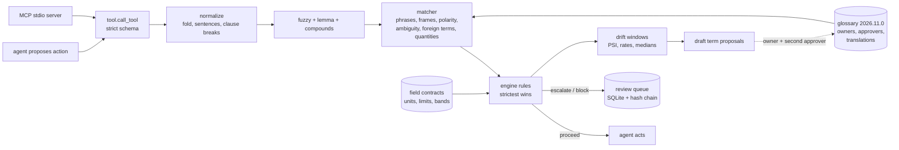

# Semantic layer gap closure

Follow-up to [Jagadish-semantic-engineering-layer](https://github.com/jagadishmazure-jpg/Jagadish-semantic-engineering-layer) (commit `e290442`). That repo shows why an agent needs governed meanings before it acts. This repo closes the gaps it listed or that probing found, then measures the result on a **held-out set the engine never saw**.

**Recruiter summary.** The original layer scored 1.0 on 30 cases its author labelled. On 318 new held-out cases it scored 0.346 accuracy, with 102 unsafe proceeds and 12 crashes. The labels came from a facts-only oracle, and the split was frozen by hash before any engine work. This engine adds negation, hedging, typo tolerance, Spanish, French and German, units, timestamps, text-vs-source cross-checks, domain routing, declared ambiguity, governance, a persisted review queue, drift monitoring and a stdio MCP server. On the same split it scores 0.965, with 2 unsafe proceeds and 0 crashes, and it still scores 1.0 on the original 30. All data is synthetic, every company is fictional, and everything runs offline with no API keys.

## Purpose and who it is for

- **Data and AI engineers** putting an agent in front of domain text, such as ops chat or case notes, where "positive", "clear" or "30 hours" can trigger an irreversible action.
- **Reviewers** who want to see what it takes to turn "1.0 on my own cases" into a claim that holds up.
- **The owner (and interviewers)**, as a worked example of negation, held-out evaluation, ablation and glossary governance without an LLM.

This repo does not repeat the original's motivation, glossary design or baseline comparison. Read the original first.

## The gaps and how each was closed

The "before" numbers come from the original code, vendored unchanged at `reference/original_e290442/`. The "after" numbers come from this engine on the frozen held-out **test** split. The per-gap table in the results block below is regenerated by CI.

| Gap | Where it came from | Before (original e290442) | How it was closed | After (this repo) |
|---|---|---|---|---|
| Score was author-labelled (1.0 on 30) | original README | no held-out set | Facts-only label oracle ([label policy](docs/label-policy.md)); phrase bank split even/odd into dev/test with disjoint phrasings, frames and orgs; test split frozen by SHA-256 before engine work; tuned on dev, ran test once ([protocol](docs/heldout-protocol.md)) | test: 0.346 → 0.965 accuracy, Wilson 95% CIs reported |
| Negation | original limitations | "File is not clear to close" → **proceed** | Cue lists in four languages, scoped to 3 tokens before, inside the frame and 2 after, stopping at clause breaks. A negated clearance never clears. A negated critical term escalates to a person. | negation: 0.000 → 1.000, 7 → 0 unsafe |
| Hedges and conditionals | found by probing | "Book courier once crossmatch negative" → **proceed** | Hedge cues ("once", "if", "likely", "pending", ...) treated like negation | hedge: 0.059 → 0.941, 9 → 0 unsafe |
| Typos | original limitations | "positive crossmtch" → **proceed** | Restricted edit distance (OSA). Max distance 1 for ≤7 letters, 2 for longer, minimum length 5, and a protected word list. Ties are refused unless every candidate has the same signal. A corrected clearance never clears. | typo: 0.213 → 0.957, 16 → 1 unsafe |
| Synonyms, abbreviations, word order | parent brief | "Positive cross-match", "crossmatch result: positive" → miss | Lemmas, compound joins, and slot frames (head + value within a window, no clause break) | synonym_variant: 0.586 → 1.000 |
| Multilingual (es, fr, de) | parent brief | Spanish text → refuse to guess, or proceed on a valid reading | Per-language translations, each with its own approval status and reviewer. A draft translation escalates. | multilingual: 0.379 → 0.966, 4 → 0 unsafe |
| Unit conversion | parent brief | "hours" and "hr" rejected | Unit aliases, ISO-8601 durations, °F/K to °C, and a temperature-band contract. "m" (ambiguous) and months (unsupported) escalate. | units: 0.372 → 1.000 |
| Timestamps | found by probing | mixed time zones or missing `now` → **crash** | Readings from start/now, refusing a mixed aware/naive pair. Naive pairs are noted in the trace. | timestamps: 8 → 0 crashes, 0.333 → 1.000 |
| Malformed input | found by probing | NaN → **proceed**; None → **crash** | Strict reading schema: finite numbers only, no bools or strings, no negatives, no extra keys | malformed_input: 8 unsafe + 4 crashes → 0 + 0 |
| Numbers only in text | found by probing | "xm neg, cold ischemia 30 hours" → **proceed** | Quantities in text are tied to the nearest field mention. Expired → block. Text-only → escalate. Text vs source disagreement > 1% of limit → escalate. | text_quantity: 0.103 → 1.000, 35 → 0 unsafe |
| Field named, no reading | found by probing | proceed | Escalate when the text names a governed field that has no reading | 8 → 0 unsafe |
| Wrong domain routing | found by probing | "clear to close, crossmatch positive" in mortgage → **proceed** | Approved critical phrases from other domains escalate | cross_domain: 8 → 0 unsafe |
| Ambiguous abbreviations | parent brief | n/a | Declared per domain ("OOS", "COC") and always escalate | 4 → 0 unsafe |
| Glossary versioning and conflicts | parent brief | version field only | `governance.validate` (duplicate synonyms, cue-word synonyms, missing contracts, two-person rule, unreviewed translations, fuzzy collisions); `governance.diff` (version bumps, weakened signals need a second approver); `replay` under an archived version | [tests/test_governance.py](tests/test_governance.py) |
| Drift | parent brief | none | Unrecognised, correction and escalation rates; PSI over term mix; per-field median ratio (catches a silent unit change at the source); candidate-phrase miner that only proposes **draft** terms | drift demo below |
| In-process review queue | original built-vs-planned | Python list, lost on exit | SQLite, append-only, SHA-256 hash chain, idempotent enqueue, named-human resolution, text hash rather than raw text | [tests/test_queue_tool_mcp.py](tests/test_queue_tool_mcp.py) |
| No real MCP transport | original built-vs-planned | in-process call | JSON-RPC 2.0 over stdio (initialize, tools/list, tools/call, ping), standard error codes, line size cap; tested as a subprocess | same file |
| Novel paraphrases | original limitations | miss | **Still open.** A phrase list does not understand meaning. Draft-term mining helps owners catch up. | novel_phrasing: 0.462 → 0.462, 1 unsafe left |

## Results

<!-- RESULTS:START -->
Synthetic data, measured by `python scripts/render_readme.py`. Tests: 185 collected, 185 passed. Held-out test split: 318 cases labelled by a facts-only oracle, frozen by SHA-256 before engine work and run once.

**Original 30 author-labelled cases (regression check):** original layer accuracy 1.000, gap closure 1.000, unsafe proceeds 0.

**Held-out test split, overall:**

| System | Accuracy (95% CI) | Critical recall (95% CI) | Unsafe proceeds | Crashes | Proceed recall |
|---|---|---|---|---|---|
| naive_baseline | 0.148 [0.113, 0.191] | 0.101 [0.056, 0.176] | 220 | 0 | 0.698 |
| original_layer | 0.346 [0.296, 0.4] | 0.172 [0.11, 0.258] | 102 | 12 | 0.679 |
| gap_closure | 0.965 [0.939, 0.981] | 0.919 [0.849, 0.958] | 2 | 0 | 0.981 |

**Per gap, original (commit e290442) vs this repo:**

| Gap (held-out test) | n | Original accuracy | New accuracy | Original unsafe proceeds | New unsafe proceeds | Original crashes |
|---|---|---|---|---|---|---|
| control | 26 | 1.000 | 1.000 | 0 | 0 | 0 |
| synonym_variant | 29 | 0.586 | 1.000 | 1 | 0 | 0 |
| negation | 16 | 0.000 | 1.000 | 7 | 0 | 0 |
| multilingual_negation | 3 | 1.000 | 1.000 | 0 | 0 | 0 |
| hedge | 17 | 0.059 | 0.941 | 9 | 0 | 0 |
| typo | 47 | 0.213 | 0.957 | 16 | 1 | 0 |
| multilingual | 29 | 0.379 | 0.966 | 4 | 0 | 0 |
| units | 43 | 0.372 | 1.000 | 0 | 0 | 0 |
| timestamps | 12 | 0.333 | 1.000 | 0 | 0 | 8 |
| malformed_input | 20 | 0.400 | 1.000 | 8 | 0 | 4 |
| text_quantity | 39 | 0.103 | 1.000 | 35 | 0 | 0 |
| direction | 4 | 1.000 | 1.000 | 0 | 0 | 0 |
| field_without_reading | 8 | 0.000 | 1.000 | 8 | 0 | 0 |
| cross_domain | 8 | 0.000 | 1.000 | 8 | 0 | 0 |
| ambiguous_abbrev | 4 | 0.000 | 1.000 | 4 | 0 | 0 |
| novel_phrasing | 13 | 0.462 | 0.462 | 2 | 1 | 0 |

**Drift demo (synthetic windows):** stable window alerts 0; drifted window alerts 2 (PSI 0.2848); top draft candidate 'vxm' (count 33).
<!-- RESULTS:END -->

The full tables, ablation and every miss are in [results/heldout_eval.md](results/heldout_eval.md).

**Ablation:** turning off any single feature raises unsafe proceeds on the test split. The biggest drops come from turning off text quantities (24 unsafe), fuzzy matching (16) and inflection (12). `tests/test_ablation_and_eval.py` enforces this on dev for every flag.

## Architecture



## How it works

1. **Normalize.** Fold accents and case, split into sentences, and keep commas and dashes as clause breaks so cues cannot leak across clauses.
2. **Repair words.** Lemmas and compound joins come first. Fuzzy correction applies only to tokens in the domain vocabulary, never to protected words, and is refused on ties between signals.
3. **Match.** Exact phrases are matched longest first, including approved translations. Slot frames ("crossmatch ... positive") come next. Then dangling checks: a polarity word with no term, or a critical topic with no outcome, escalates.
4. **Polarity.** Negation and hedge cues are read in the window around each hit.
5. **Routing and ambiguity.** Critical phrases from other domains, and declared ambiguous abbreviations, escalate.
6. **Readings.** Structured readings are checked against contracts. Quantities in text are cross-checked against them.
7. **Decide.** The strictest outcome wins. Proceed also needs a clearance: an exact, factual clearance term or a valid reading.
8. **Record.** Every decision carries the glossary version and hash. Anything that is not a proceed goes to the review queue.

More detail: [docs/how-it-works.md](docs/how-it-works.md).

## Real code and output

```python
# src/semgap/engine.py (excerpt)
if t.signal == "critical_block":
    if h.negated or h.hedged:
        kind = "negated" if h.negated else "hedged"
        bump("escalate", f"{t.id} is {kind} ('{h.cue}'): a person must confirm, never auto-proceed")
    else:
        bump("block", f"{t.id}: {t.definition}" + (" (matched after spelling correction)" if h.fuzzy else ""))
elif t.signal == "clear":
    if h.negated or h.hedged:
        bump("escalate", f"{t.id} is {'negated' if h.negated else 'hedged'} ('{h.cue}'): not a clearance")
    elif h.fuzzy:
        bump("escalate", f"{t.id} only matched after spelling correction: clearance must be exact")
```

`PYTHONPATH=src python examples/demo.py` (real output, reasons trimmed):

```text
'File is not clear to close'             original=proceed           new=escalate  MTG.CTC is negated ('not'): not a clearance
'Book courier once crossmatch negative'  original=proceed           new=escalate  MED.XM_NEGATIVE is hedged ('once'): not a clearance
'xm neg, cold ischemia 30 hours'         original=proceed           new=block     cold_ischemia_elapsed in text is outside its limit (30.0h elapsed of 24h)
'crossmatch negative' + NaN reading      original=proceed           new=escalate  cold_ischemia_elapsed: value must be finite
'clear to close, crossmatch positive'    original=proceed           new=escalate  text names MED.XM_POSITIVE from medical_logistics: domain routing may be wrong
'Positive cross-match'                   original=proceed           new=block     MED.XM_POSITIVE: Recipient antibodies react against donor cells...
'positive crossmtch'                     original=proceed           new=block     MED.XM_POSITIVE ...
'prueba cruzada positiva'                original=proceed           new=block     MED.XM_POSITIVE ...
'crossmatch negative' + mixed-tz reading original=crash (TypeError) new=escalate  one timestamp has a timezone and the other does not
```

## How to run (offline, standard library only)

```bash
python -m venv .venv && . .venv/bin/activate && pip install -r requirements-dev.txt
python scripts/count_tests.py                 # prints TOTAL_TESTS=...
PYTHONPATH=src python -m semgap.evaluate      # writes results/heldout_eval.{json,md}
PYTHONPATH=src python examples/demo.py
python scripts/render_readme.py --check       # README numbers match a fresh run
sha256sum -c heldout/FROZEN.sha256            # test split unchanged
PYTHONPATH=src python -m semgap.mcp_server    # JSON-RPC over stdio; queue at var/review_queue.sqlite
python labeling/kappa.py export --n 60        # blind sheet for real expert labelling
```

There is no cloud part and nothing is billable.

## Guardrails

- Fail safe: unknown, malformed, negated, hedged, misspelled-clearance, ambiguous, foreign-domain, text-only and draft inputs all escalate, and the strictest outcome wins.
- Proceed needs positive evidence (a clearance), not just the absence of a problem.
- Draft terms and draft translations can never clear or block on their own.
- Two-person rule: the approver must differ from the owner, translations need a named reviewer, and a weakened signal needs a second approver.
- The review queue is append-only and hash-chained, can only be resolved by a named human, and stores a text hash rather than raw text.
- The tool schema is strict: enum domain, 4000-character text cap, no extra keys. The MCP server caps line size.
- The held-out test split is checked against its SHA-256 in CI.

See [docs/guardrails.md](docs/guardrails.md) and [docs/threat-model.md](docs/threat-model.md).

## Limitations (kept as tests in `tests/test_known_limits.py`)

- Novel paraphrases ("deferred interest added to principal") are not understood. With a valid reading this is an unsafe proceed (1 on test).
- Negation that splits a non-English multi-word term ("prueba cruzada no positiva") hides the term.
- A typo on a non-term word in a clearance sentence still proceeds. The oracle says escalate (1 on test).
- Decimal commas ("25,5 h") are misread. A fuzzy tie can pick the wrong language form (fails safe). A trailing modal ("neg am may apply") blocks where the oracle escalates.
- Labels are synthetic and come from one author's phrase bank. Independence comes from fact-derived labels and the freeze, not from separate people. A kappa kit is included but has not been run with experts.
- Limits are lab values, not clinical, actuarial or lending policy.

Full list: [docs/limitations.md](docs/limitations.md).

## Built vs planned

| Item | Status |
|---|---|
| Held-out dev/test with facts-only oracle, frozen hash | Built, run |
| Negation, hedging, fuzzy, multilingual, inflection, frames | Built, measured |
| Units, ISO durations, timestamps, temperature band contract | Built, measured |
| Text-quantity cross-check, field-without-reading, cross-domain, ambiguity | Built, measured |
| Ablation per feature, Wilson CIs | Built, run |
| Governance validate / diff / changelog / replay | Built, tested |
| SQLite hash-chained review queue | Built, tested |
| MCP-style stdio JSON-RPC server | Built, tested as a subprocess; not tried with a third-party MCP client |
| Drift monitor and draft-term miner | Built, run on synthetic windows |
| Expert annotation kit (Cohen's kappa) | Written, not run with humans |
| Glossary approval UI | Planned (CLI and JSON only) |
| Meaning-level understanding of novel paraphrases | Planned; out of reach for a phrase list |
| CI (ruff, pytest, docs check, brand check, gitleaks), CodeQL default setup | Built, runs on GitHub |

## Docs

[how it works](docs/how-it-works.md) · [guardrails](docs/guardrails.md) · [limitations](docs/limitations.md) · [implementation guide](docs/implementation-guide.md) · [interview points](docs/interview-points.md) · [threat model](docs/threat-model.md) · [ADRs](docs/adr/) · [training: labs and capstone](docs/training.md) · [label policy](docs/label-policy.md) · [held-out protocol](docs/heldout-protocol.md)

## Related repos

- [Jagadish-semantic-engineering-layer](https://github.com/jagadishmazure-jpg/Jagadish-semantic-engineering-layer): the original. Motivation, base glossary, baseline comparison and the semantic engineering checklist live there.

MIT licence. Synthetic data only. Organisation names (Northwind, Contoso, Fabrikam, Kestrel, Larkspur, Brambleton, Tidewell, Quillmark) are fictional.
